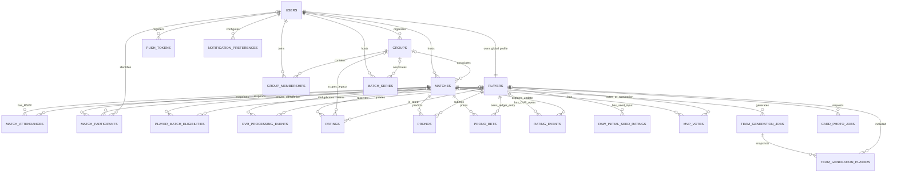

# Database Schema and Ownership Boundaries

Status: Current code-schema inventory plus explicitly marked planned records
Last reviewed: 2026-08-06

The Drizzle schema under `apps/api/src/db/schema/` and the applied migration journal are the implementation source of truth. This document is a human-readable aid, not permission to change a database. It must be updated in the same reviewed change as any schema migration.

## 1. Relationship diagram

Solid relationships below represent current declared foreign keys. Relationships described as logical-only in the table inventory are not database-enforced today.

`ratings.rater_player_id`, `raw_initial_seed_ratings.rater_user_id`, `matches.series_id`, `matches.mvp_player_id` and some logical event references are intentionally visible in code but are not all declared foreign keys. This is an integrity review item, not a relationship to assume.

## 2. Current table inventory

Every current table uses a UUID `id` primary key unless noted otherwise.

| Table | Plain-language purpose | Key ownership and foreign keys | Important uniqueness/indexes | Retention/privacy boundary |
|---|---|---|---|---|
| `users` | Internal account/profile linked to external authentication | `clerk_user_id` maps to Clerk | unique `clerk_user_id`; checked `profile_field_visibility` JSONB | Contains email, profile photo URL and personality fields; every visibility key defaults private; owner/private DTO rules apply; soft deletion/purge timestamps exist |
| `players` | One global football identity, OVR/card projection and pronostic balance per account | `user_id -> users.id` | unique `user_id` | Global across crews; soft deletable; OVR, attendance/reliability and pronostics remain conceptually separate |
| `groups` | Crew configuration and organizer ownership | `organizer_id -> users.id` | unique nullable `invite_code` | Crew administration; removal must not erase historical participation |
| `group_memberships` | Many-to-many user/crew membership and role | `group_id -> groups.id`; `user_id -> users.id` | unique `(group_id, user_id)` | `deleted_at` ends membership; historical match/participant records must remain |
| `matches` | Standalone or crew-associated match, venue, visibility, status and result | `host_id -> users.id`; nullable `group_id -> groups.id`; `series_id`/`mvp_player_id` currently not declared FKs | indexes `(visibility, scheduled_at)`, `(latitude, longitude)`, `(group_id, scheduled_at)` | Exact venue/notes and administration require audience-specific DTOs; cancellation/completion retained according to future policy |
| `match_series` | Recurring match template | `host_id -> users.id`; nullable `group_id -> groups.id` | no occurrence uniqueness currently declared | Operational template; ended series retained per policy TBD |
| `match_attendances` | Current RSVP/waitlist and source for a match | `match_id -> matches.id` cascade; nullable `player_id -> players.id` | unique `(match_id, player_id)` | Current status is RSVP, not final attendance outcome; player can be nulled for deletion safety |
| `match_participants` | Team/result snapshot including goals and assists | `match_id -> matches.id` cascade; nullable `player_id -> players.id`; nullable `user_id -> users.id` | no declared `(match, player)` uniqueness | Historical snapshot; display name is denormalized and must be randomized/anonymized where required |
| `ratings` | Raw football/personality rating inputs | nullable `match_id -> matches.id`; nullable `group_id -> groups.id`; `rated_player_id -> players.id`; rater remains nullable for GDPR handling | unique `(match_id, rater_player_id, rated_player_id)`; null semantics preserve legacy initial rows | Raw rows and rater IDs are internal only; no individual rating is exposed to the subject/public; new initial rows are disabled |
| `player_match_eligibilities` | Canonical unique completed-match evidence used by the global card/count projection | `match_id -> matches.id`; `player_id -> players.id` | unique `(match_id, player_id)`; player index | Phase 1 evidence version proves final snapshot presence, not final attendance; invalidation fields support later correction without redesign |
| `ovr_processing_events` | Database claim that one match/player/type OVR update committed | `match_id -> matches.id`; `player_id -> players.id` | unique `(match_id, player_id, processing_type)`; player index | Internal idempotency record; never serialized to mobile/public APIs |
| `pronos` | Legacy one-prediction-per-player/match record | `match_id -> matches.id` cascade; `player_id` and optional MVP prediction -> `players.id` | unique `(match_id, player_id)` | Secondary engagement data; separate from OVR |
| `prono_bets` | Append-only fictional bankroll ledger | `match_id -> matches.id` cascade; `player_id -> players.id` | indexes by match, player and `(match, status)`; multiple bets allowed | Reconstructs the fixed 1,000-point economy; must remain separate from OVR/reputation |
| `rating_events` | OVR seed/update audit record with JSON breakdown | `player_id -> players.id`; nullable `match_id -> matches.id` | unique `(match_id, player_id, event_type)` for non-null match events | Internal audit data; breakdown must never be returned wholesale and may contain sensitive references |
| `raw_initial_seed_ratings` | Historical inputs used by initial OVR seeding | `player_id -> players.id`; rater user is logical-only and nullable | none declared | Raw/rater evidence is internal; onboarding-rating future is blocked by ADR-020 |
| `mvp_votes` | One MVP nomination by each voter for a match | match and both player roles have FKs | unique `(match_id, voter_player_id)` | Voter identity is sensitive and should not be exposed to nominees/public |
| `team_generation_jobs` | Team-generation attempt and fairness status | `match_id -> matches.id`; nullable `group_id -> groups.id` | unique external `job_id` | Operational record; retention duration TBD |
| `team_generation_players` | Player/team/OVR snapshot for a generation job | `job_id -> team_generation_jobs.id`; nullable `player_id -> players.id` | none declared | Preserves generation evidence; player nullable for purge safety |
| `card_photo_jobs` | Optional card-image generation job | `player_id -> players.id`; nullable legacy `group_id -> groups.id` | unique `idempotency_key` | Photo URL/error may be sensitive; owner-only lifecycle and object deletion required |
| `push_tokens` | Device push delivery tokens | `user_id -> users.id` | unique `(user_id, token)` | Secret-like device identifier; never public; delete on invalidation/account purge |
| `notification_preferences` | Per-user notification choices | `user_id -> users.id` | unique `(user_id, type)` | Owner-only preference data |

## 3. Required domains not yet represented safely

These appear in the product/roadmap but do not yet have final database records. Their absence must remain visible in Phase 8 diagrams and migration reviews.

| Domain | Current approximation | Required future integrity boundary |
|---|---|---|
| Final attendance and reliability | RSVP in `match_attendances`; counters on `players` | Explicit finalized attended/excused/no-show outcome, late/cancellation evidence, disputes and unique match/player record |
| Behaviour/fair play | No dedicated table | Structured report, subject, reporter, match, category, resolution, validator and audit timestamps |
| Player-card eligibility | Phase 1 snapshot-versioned `player_match_eligibilities`; cached `players.match_count/card_state` | Strengthen creation with finalized attended outcome; correction/re-lock policy remains open |
| OVR processing idempotency | `ovr_processing_events` plus first-class nullable `rating_events.match_id` | Durable scheduler remains future work; current processing is DB-idempotent |
| Durable notifications/jobs | Flags and feature-specific job tables | Outbox/job records with deduplication, retry, delivery and terminal status |
| Versioned photo consent | Boolean and URL on `players` plus photo job | Purpose/version/timestamp/withdrawal, source/output object metadata, moderation and deletion evidence |
| Field-level profile visibility | `users.profile_field_visibility` implemented by additive migration `0017` | Extend the checked key set with safe defaults when new fields are introduced; no real-data inference |

No Phase 8 infrastructure work may silently invent these migrations; they belong to the approved functional phases and must pass their own data-integrity gates first.

## 4. Ownership boundaries

- `users` owns account/profile and privacy lifecycle.
- `players` owns the unique global football identity and its projections; it is never crew-specific.
- `player_match_eligibilities` owns canonical eligible-match evidence; `players.match_count` is a transitional cache, not an independent source of truth.
- `ovr_processing_events` owns OVR trigger idempotency; `rating_events` owns the internal mathematical audit result.
- `group_memberships` owns current crew membership; `match_participants` owns historical participation.
- `matches` is the canonical match/listing; no duplicate marketplace entity exists.
- `match_attendances` owns RSVP/waitlist only until explicit final-attendance records are introduced.
- `ratings` owns raw rating evidence; only privacy-safe aggregates may leave the server.
- `prono_bets` owns bankroll ledger evidence; the cached player balance is a projection.
- Object storage owns image bytes; database URLs/job records do not prove object deletion.
- External authentication owns credentials/sessions; the app database stores only the external identity reference and app profile.

## 5. Retention and deletion rules

Exact periods require Phase 8 legal approval and must then replace every `TBD` in the ownership register. Until then:

- minimize raw personal data and logs;
- never use soft deletion as proof of object-storage or processor deletion;
- preserve legally/product-required historical match integrity using approved anonymization rather than accidental cascade;
- delete push tokens and optional photo objects when their purpose ends;
- retain raw ratings/reports only for an approved purpose and duration with subject/rater privacy;
- keep financial-like pronostic ledger consistency without representing fictional points as money;
- keep backups subject to a documented expiry and delayed-deletion disclosure.

## 6. Schema synchronization procedure

For each schema change:

1. Update Drizzle schema and create a reviewed migration.
2. Update this table inventory and Mermaid diagram.
3. Record new/changed PKs, FKs, uniques, indexes, data categories and ownership.
4. Update retention/deletion and public/private serializer effects.
5. Run isolated migration, rollback/forward-fix and reconciliation checks.
6. Regenerate any visual ERD from the reviewed schema without production credentials or personal data.
7. Attach dated staging evidence during Phase 8; never use a production screenshot containing data.
