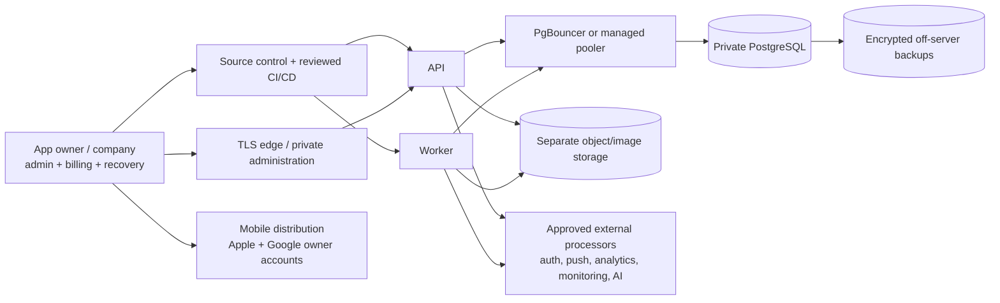

# Infrastructure Ownership and Processor Register

Status: Phase 8 planning template; no production approval
Last reviewed: 2026-08-06

This register must be completed and verified by the app owner before any paid provisioning or production launch. `TBD` means no evidence has been accepted. Repository references identify technical dependencies, not account ownership, billing control, contractual status, live deployment or processing region.

No developer, contractor or automated coding tool may be the sole owner of a critical account. The app owner or their company must control administrator access, billing and recovery for every critical service.

## 1. Proposed infrastructure boundary

This diagram shows required boundaries, not a selected provider or deployed system. ADR-022 must choose and verify the hosting implementation.

PostgreSQL is never public. Production administration uses a private network, VPN, provider-controlled connector or owner-approved SSH tunnel. Staging and production have separate databases, credentials, secrets, buckets and URLs.

## 2. Approval rules

- Never put passwords, recovery codes, tokens, private keys or full connection strings in this document.
- Verify account control by an owner-access review, not by a developer's statement.
- Verify actual processing/storage regions in the provider console and contract; company headquarters are not region evidence.
- Record a dated DPA/processor review and international-transfer mechanism where applicable.
- Optional photo transformation remains disabled in production until every processor in that path is approved.
- Record changes to owner, region, processor, retention, pricing or deletion procedures within five business days.

## 3. Ownership register

| Service | Purpose / evidence | Account owner | Billing owner | Recovery email | Environment | Region/data location | Data categories | Admin access | Backup/recovery | Deletion | DPA / renewal | Responsible person | Verification status |
|---|---|---|---|---|---|---|---|---|---|---|---|---|---|
| Source-code repository / GitHub | Source, CI and SSH deployment workflow | TBD | TBD | TBD | all | TBD | source, issues, CI metadata, encrypted secrets | Owner-controlled organization with MFA | repository export/mirror; recovery owner | repository/account deletion procedure TBD | Terms/DPA and billing TBD | TBD | Unverified |
| Server/cloud provider / Hetzner reference | Repository runbook describes a Hetzner VPS; topology is not verified live | TBD | TBD | TBD | proposed staging/production | Country/datacenter TBD | API runtime, logs, possibly all database data | Owner-controlled console, MFA and named admins | snapshot/rebuild procedure TBD | server/account deletion procedure TBD | DPA, subprocessors and renewal TBD | TBD | Prior intent only |
| PostgreSQL | Canonical transactional application database | TBD | TBD | TBD | separate local/test/staging/production | Must match selected EU hosting decision | accounts, profiles, matches, attendance, ratings, pronostics, consent/job metadata | Private network/tunnel; separate app/migration/read-only/emergency roles | encrypted off-server backup plus tested restore | retention-aware record/account deletion | Hosting DPA applies | TBD | Local/test only evidenced |
| Database backup storage / Backblaze B2 reference | Existing script uploads database dumps to B2 | TBD | TBD | TBD | proposed production | Bucket region TBD | encrypted or otherwise protected database backup | Owner-controlled console/service account | retention and restore test TBD | lifecycle and verified purge | DPA/subprocessors/transfer TBD | TBD | Script evidence only; sanitization/encryption not proven |
| Object/image storage / Backblaze B2-compatible API | Card input/output object storage | TBD | TBD | TBD | development/proposed production | Bucket region TBD | source photos, generated images, object metadata | Least-privilege service account | backup or reproducible-regeneration policy TBD | owner withdrawal, account purge and object purge | DPA/subprocessors/transfer TBD | TBD | Production use not approved |
| Authentication / Clerk | Identity, session and webhook processing | TBD | TBD | TBD | development/proposed staging/production | Processing/storage region TBD | external auth ID, session/device/security metadata | Owner-controlled Clerk instance, MFA | provider recovery/export procedure | user deletion and webhook reconciliation | DPA/subprocessors/transfer TBD | TBD | Dependency configured; ownership/region unverified |
| Email provider | Transactional/support email if introduced | TBD | TBD | TBD | TBD | TBD | recipient address and message metadata/content | TBD | TBD | suppression/log/contact deletion | DPA/subprocessors/transfer TBD | TBD | No provider identified in repository |
| Push notifications / Expo Push Service and platform push services | Mobile notification delivery | TBD | TBD | TBD | development/proposed production | Processing region TBD | push token, notification metadata/content | Expo/Apple/Google owner-controlled accounts | token re-registration; no backup assumption | invalidate token and delete server record | Terms/DPA/subprocessors/transfer TBD | TBD | Technical dependency present; account ownership unverified |
| Analytics / PostHog | Product analytics | TBD | TBD | TBD | development/proposed production | Project hosting region TBD | device/user pseudonymous analytics and events | Owner-controlled project with MFA | export/retention policy TBD | identity/event deletion procedure | DPA/subprocessors/transfer TBD | TBD | Mobile environment key referenced; production approval absent |
| Error monitoring / Sentry | API/mobile errors and performance | TBD | TBD | TBD | development/proposed production | Project region TBD | stack traces, request/device metadata; personal data must be filtered | Owner-controlled organization/project | export/retention procedure | issue/event/user deletion procedure | DPA/subprocessors/transfer TBD | TBD | Configuration references exist; production approval absent |
| AI generation / Google Gemini | Optional card-photo transformation | TBD | TBD | TBD | development only until approved | Processing region and model retention TBD | source photo/prompt/generated image depending on implementation | Owner-controlled project/key | no provider backup assumption | provider request/log deletion plus object purge | DPA/subprocessors/transfer/legal basis TBD | TBD | Must remain disabled in production |
| Image moderation / AWS Rekognition | Optional image/face moderation | TBD | TBD | TBD | development only until approved | Configured resource region must be verified; code fallback is not evidence | submitted image and moderation result | Owner-controlled AWS account/role with MFA | no provider backup assumption | request/log and stored-result deletion | DPA/subprocessors/transfer/legal basis TBD | TBD | Must remain disabled in production |
| Domain registrar | Domain ownership and renewal | TBD | TBD | TBD | production | Registrar/account jurisdiction TBD | registrant/contact/billing data | Owner-controlled account, MFA and transfer lock | recovery codes and registrar recovery | domain transfer/closure procedure | renewal date and billing alert TBD | TBD | No registrar identified |
| DNS provider | API/app DNS and certificate validation | TBD | TBD | TBD | staging/production | Provider region TBD | DNS records and operational metadata | Owner-controlled account, MFA and least privilege | zone export | zone/account deletion | DPA/renewal TBD | TBD | No provider identified |
| Apple Developer account | iOS signing, distribution, push and store listing | TBD | TBD | TBD | staging/production | Apple processing locations TBD | signing/store/team/user and notification metadata | Organization-owned team, at least two trusted admins | recovery contacts/keys | app/account/data removal procedure | annual renewal/DPA/terms TBD | TBD | Ownership not evidenced |
| Google Play Console / Firebase where used | Android signing/distribution; platform notifications if used | TBD | TBD | TBD | staging/production | Google processing locations TBD | signing/store/team/user and notification metadata | Organization-owned account, at least two admins | key/recovery procedure | app/account/data removal procedure | fees/DPA/terms TBD | TBD | Ownership not evidenced |
| Monitoring/uptime provider | Infrastructure, API, certificate and backup alerts | TBD | TBD | TBD | staging/production | Region TBD | metrics, logs, host/service identifiers | Owner-controlled project and alert destinations | configuration export | metric/log/account deletion | DPA/subprocessors/pricing TBD | TBD | No provider selected |

## 4. Environment matrix

| Control | Local development | Automated test | Staging | Production |
|---|---|---|---|---|
| Status | Existing local configuration; database target not approved for audit | Isolated PostgreSQL test configuration exists | Compose proposal exists; live environment unverified | Legacy Compose/runbook proposal exists; deployment not approved |
| Database | Local-only, never production | Disposable `TEST_DATABASE_URL`; tmpfs/CI | Separate database required; synthetic/anonymized data only | Separate private database required |
| Credentials/secrets | Developer-scoped | Ephemeral test-only | Separate staging secrets | Rotated production-only secrets |
| Storage bucket | Local/test substitute preferred | Fake/isolated | Separate staging bucket | Separate production bucket |
| API URL | Localhost/private LAN | Test process | Separate staging URL | Production URL |
| Personal data | Minimal local fixtures | Synthetic only | Synthetic or approved anonymized data | Allowed only after legal/security launch gate |
| Owner approval | Not a production approval | Not a production approval | Required before provisioning | Required before provisioning and launch |

Production credentials must never be copied into local or test environments. Staging may not receive production personal data unless an approved anonymization process is documented, tested and applied before transfer.

## 5. European location and transfer register

Complete this from provider consoles and contracts before staging/production approval.

| Processing surface | Country/datacenter region | Storage location | Backup location | Processing location | Transfer outside Switzerland/EEA/approved jurisdiction | Evidence/date | Reviewer |
|---|---|---|---|---|---|---|---|
| API/server | TBD | TBD | n/a | TBD | TBD | TBD | TBD |
| PostgreSQL | TBD | TBD | see backups | TBD | TBD | TBD | TBD |
| Database backups | TBD | TBD | TBD | TBD | TBD | TBD | TBD |
| Images/object storage | TBD | TBD | TBD | TBD | TBD | TBD | TBD |
| Authentication | TBD | TBD | provider-managed | TBD | TBD | TBD | TBD |
| Analytics | TBD | TBD | provider-managed | TBD | TBD | TBD | TBD |
| Error monitoring | TBD | TBD | provider-managed | TBD | TBD | TBD | TBD |
| Push notifications | TBD | TBD | provider-managed | TBD | TBD | TBD | TBD |
| AI image generation | TBD | TBD | provider-managed | TBD | TBD | TBD | TBD |
| Image moderation | TBD | TBD | provider-managed | TBD | TBD | TBD | TBD |

Any non-approved transfer blocks launch until the transfer mechanism, legal basis, data minimization and owner/legal approval are recorded.

## 6. Legal basis and retention worksheet

This is an engineering inventory, not legal advice. Professional GDPR and Swiss data-protection review is required before public launch.

| Data category | Purpose | Proposed legal basis | Retention trigger/period | Access/export | Correction | Deletion | Approved |
|---|---|---|---|---|---|---|---|
| Account identity | Authentication and account operation | TBD by legal review | TBD | Process TBD | Process TBD | Account-deletion process required | No |
| Global player profile | Player identity and app functionality | TBD | TBD | Required | Required | Required subject to justified records | No |
| Location/preferred area | Match discovery | TBD | Minimize precision and retention; TBD | Required | Required | Required | No |
| Match participation | Organize and evidence matches | TBD | TBD | Required | Correction/dispute process | Retention/anonymization policy TBD | No |
| Football ratings | Ability aggregation | TBD | Raw/aggregate retention TBD | Aggregate-only subject access design | Dispute/correction policy | Rater privacy and deletion policy TBD | No |
| Attendance/reliability | Commitment history | TBD | TBD | Safe history required | Dispute/correction required | TBD | No |
| Behaviour reports | Sportsmanship/moderation | TBD | Strictly limited; TBD | Controlled subject access | Dispute/correction required | TBD | No |
| Photos | Optional card transformation | Explicit consent or other approved basis; legal review required | Versioned consent and short purpose-limited retention | Owner-only lifecycle | Replace/regenerate | Withdrawal and object purge required | No |
| Pronostics | Optional game economy | TBD | TBD | Required | Ledger correction policy | TBD | No |
| Analytics | Product improvement | Consent/legitimate-interest analysis TBD | Minimized; TBD | Provider process | Provider process | Provider deletion process | No |
| Notifications | Requested service communication | TBD by notification type | Delivery/token retention TBD | Required where applicable | Preference correction | Token/log deletion | No |

## 7. Owner handover checklist

- [ ] Owner can identify the host, database country/region and backup region.
- [ ] Owner has billing and recovery control for every critical account.
- [ ] At least two owner-approved administrators exist where supported.
- [ ] Sole developer/contractor/tool ownership has been removed.
- [ ] Owner can grant and revoke read-only database access.
- [ ] Owner can deploy, restore a backup and invoke incident contacts using tested runbooks.
- [ ] Owner holds infrastructure and database diagrams, cost register and processor list.
- [ ] Owner can initiate user export, correction and deletion processes.
- [ ] Secret rotation and account recovery have been rehearsed without exposing secrets.
- [ ] All unknown/TBD critical fields above are resolved and dated.

Phase 8 cannot recommend launch while a critical row remains unverified.
